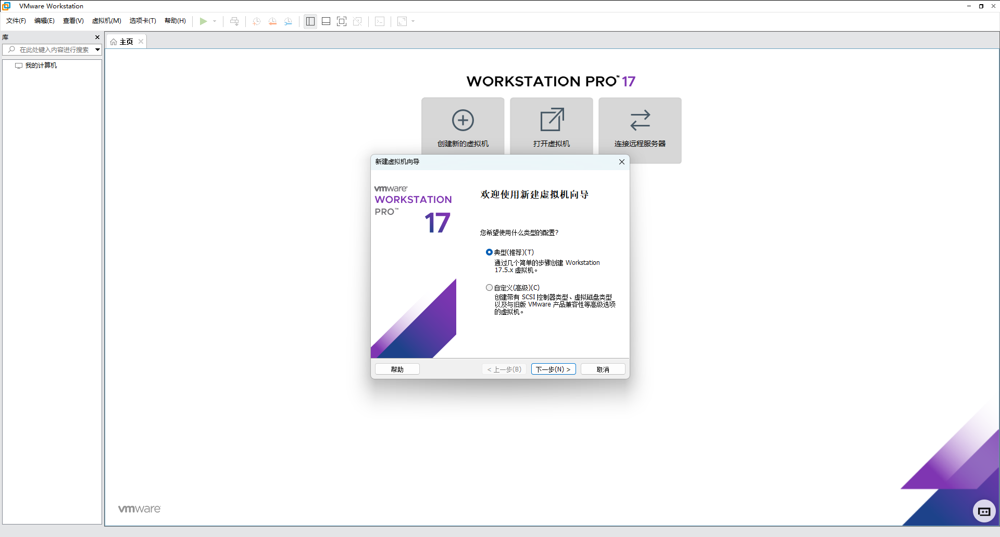
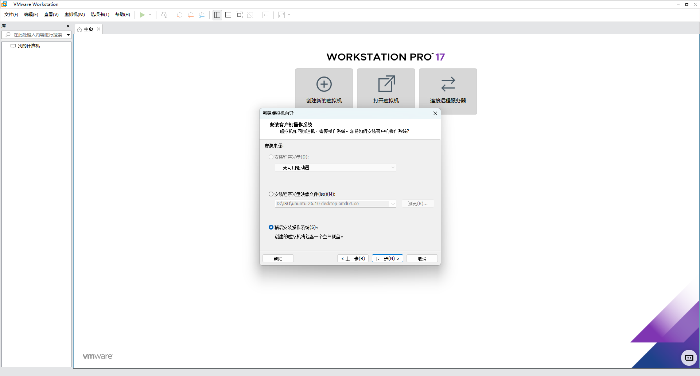
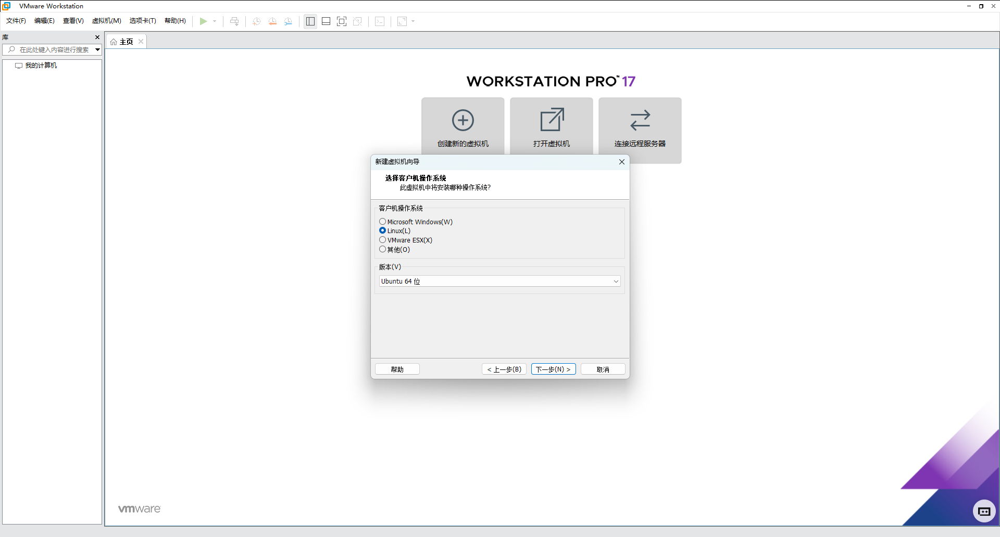
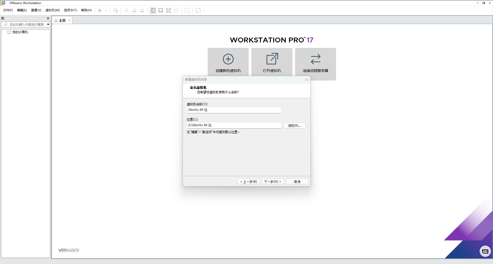
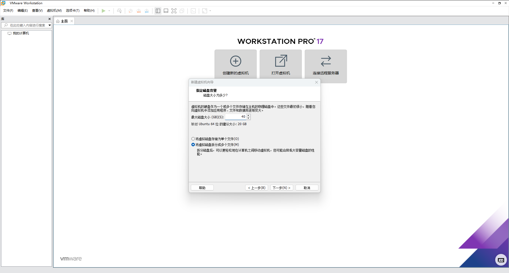
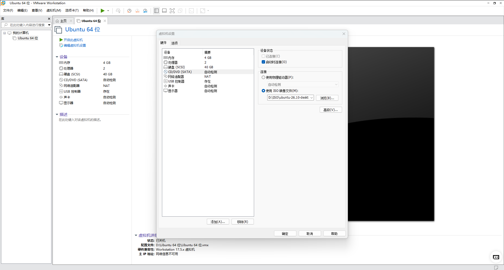
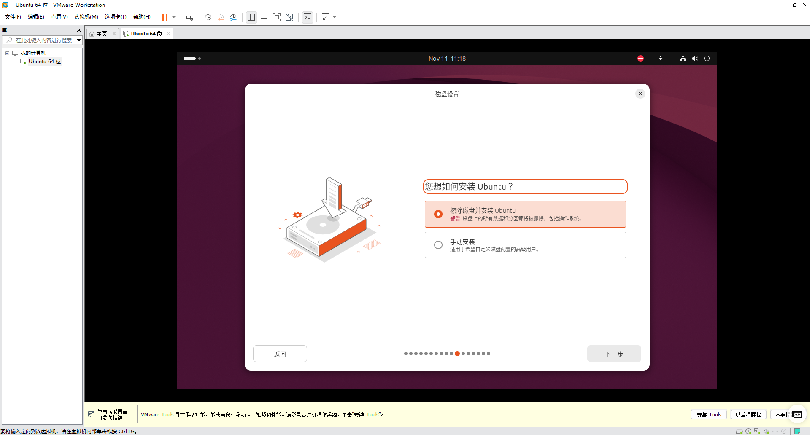
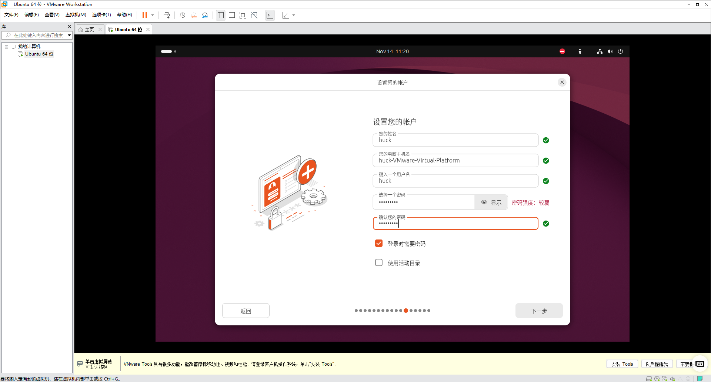
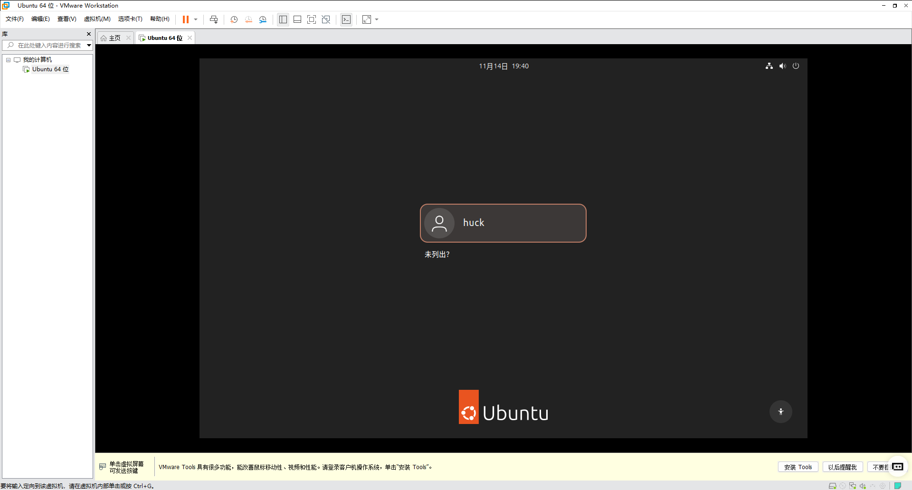

# 第 1 章 搭建实验环境：VMware + Ubuntu 本地虚拟机

> 本章带你在自己的电脑上装一台 Ubuntu 虚拟机，作为全书的实验环境。所有后续章节的命令，都可以在这台本地虚拟机里验证。**禁止把 VMware 或虚拟机文件安装到 C 盘**，请全部选 D 盘或其他非系统盘。

## 本章目标

- 下载并安装 VMware Workstation Pro 到非 C 盘
- 下载 Ubuntu ISO 镜像（清华镜像站）并保存到非 C 盘
- 创建 Ubuntu 虚拟机，虚拟磁盘和配置文件均放在非 C 盘
- 从 ISO 启动并完成 Ubuntu 安装
- 首次登录桌面，完成用户账号设置
- 截取每一步的安装截图，补充到本书（见下文“截图补充说明”）

---

## 1.1 下载并安装 VMware Workstation Pro

VMware Workstation Pro 个人非商业用途免费。

1. 访问 VMware 官网下载页面，下载 **VMware Workstation Pro for Windows**（本章使用 17 版本）。
2. 运行下载的安装引导程序，等待它联网下载完整安装包。
3. **关键：安装向导中选择“自定义安装”，将安装路径改为非 C 盘**，例如：
   ```
   D:\VMware
   ```
   千万不要使用默认的 `C:\Program Files (x86)\VMware\...`。
4. 安装完成后，如提示重启电脑，请重启。
5. 启动 VMware Workstation Pro，首次运行选择 **“免费用于个人非商业用途”**。

> ⚠️ VMware 官方安装包体积较大（数 GB），且安装向导的“自定义安装”页不一定提供路径输入框。如果向导只给了组件勾选，请在此之前用系统盘管理工具（如目录联结）把安装目录重定向到 D 盘，再执行安装。安装完成后到 `D:\VMware` 目录确认 `vmware.exe` 存在，即表示未落在 C 盘。

---

## 1.2 下载 Ubuntu 镜像

1. 访问清华镜像站 Ubuntu 目录：
   ```
   https://mirrors.tuna.tsinghua.edu.cn/ubuntu-releases/
   ```
2. 进入最新的桌面版目录（如 `26.10/`），下载 **64-bit PC（AMD64）桌面版** 的 `.iso` 文件，约 5 GB。
3. 将 ISO 文件保存到非 C 盘目录，例如：
   ```
   D:\ISO\ubuntu-26.10-desktop-amd64.iso
   ```

> 📌 国内直连 ubuntu.com 往往很慢，清华镜像站（TUNA）、阿里云、网易云等都是官方同步源，速度快且校验值一致。本书后续实验使用的版本为 **Ubuntu 26.10 LTS**。

---

## 1.3 创建 Ubuntu 虚拟机

1. 打开 VMware Workstation Pro，点击 **“创建新的虚拟机”**。
2. 选择 **典型（推荐）**，点击“下一步”。



*图 1-1　新建虚拟机向导：选择“典型（推荐）”配置*

3. 在“安装客户机操作系统”页面，选择 **“稍后安装操作系统”**（稍后手动指定 ISO，更稳妥）。



*图 1-2　选择“稍后安装操作系统”，并记录下 ISO 存放路径 `D:\ISO\ubuntu-26.10-desktop-amd64.iso`*

4. 客户机操作系统：选择 **Linux**，版本选择 **Ubuntu 64 位**。



*图 1-3　客户机操作系统选择 Linux → Ubuntu 64 位*

5. **位置：选择非 C 盘目录**，例如：
   ```
   D:\Ubuntu 64 位
   ```
   **不要放在 C 盘。** 名称保持与位置一致，方便后续区分。



*图 1-4　虚拟机名称与“位置”均指向 D 盘，未使用 C 盘*

6. 固件类型：保持默认 BIOS。
7. 磁盘容量：建议 **40 GB 或以上**，选择 **“将虚拟磁盘存储为多个文件”**。



*图 1-5　磁盘容量 40 GB，存储方式选择“将虚拟磁盘存储为多个文件”*

8. 点击 **"完成"**。虚拟机会出现在左侧库中，此时尚未启动。

---

## 1.4 挂载 Ubuntu ISO 并启动安装

1. 在虚拟机库中选中 `Ubuntu 64 位`，点击 **“编辑虚拟机设置”**。
2. 在 **CD/DVD (SATA)** 设置中，选择 **“使用 ISO 映像文件”**，浏览并指向：
   ```
   D:\ISO\ubuntu-26.10-desktop-amd64.iso
   ```



*图 1-6　虚拟机设置中 CD/DVD 已指向本地 ISO 映像文件，右侧可见硬件配置清单*

3. 同时确认右侧硬件列表中：处理器 **2** 个内核、内存 **4096 MB**、网络适配器 **NAT**、硬盘 **SCSI 40 GB**。
4. 勾选 **“启动时连接”**，点击 **“确定”**。
5. 点击 **“开启此虚拟机”**，Ubuntu 安装程序会从 ISO 启动。

---

## 1.5 安装 Ubuntu 系统

1. Ubuntu 安装程序启动后，选择语言 **中文（简体）**。
2. 键盘布局保持默认。
3. 安装类型选择 **“擦除磁盘并安装 Ubuntu”**。  
   ⚠️ 这是虚拟机内部的虚拟磁盘，**不会删除你本机 C 盘或 D 盘的数据**。



*图 1-7　Ubuntu 安装程序的“安装类型”页面，选中“擦除磁盘并安装 Ubuntu”*

4. 设置你的姓名、计算机名、用户名和密码。**请牢记，后面 sudo 和 SSH 都要用。**



*图 1-8　设置账户：姓名 `huck`、计算机名 `huck-VMware-Virtual-Platform`、用户名 `huck`*

5. 登录选项：实验机建议 **不要求密码自动登录**，方便调试；生产环境请勿这样做。
6. 等待安装完成（约 15–30 分钟），完成后点击 **"立即重启"**。
7. 重启后，在 VMware 菜单栏选择 **“虚拟机” → “可移动设备” → “CD/DVD” → “断开连接”**，避免再次从 ISO 启动。

---

## 1.6 首次登录

安装完成后重启，虚拟机进入 Ubuntu 登录界面，输入刚才设置的密码登录。



*图 1-9　Ubuntu GDM 登录界面，左下角可切换用户*

---

## 1.7 安装 VMware Tools（推荐）

VMware Tools 能改善显示分辨率、剪贴板共享、文件拖拽等体验。

1. Ubuntu 桌面登录后，在 VMware 菜单栏选择 **“虚拟机” → “安装 VMware Tools”**。
2. 系统会挂载一个虚拟光盘，打开终端运行：
   ```bash
   cd /media/$USER/VMware\ Tools
   tar xzvf VMwareTools-*.tar.gz
   cd vmware-tools-distrib
   sudo ./vmware-install.pl -d
   ```
3. 安装完成后重启虚拟机。

> 💡 Ubuntu 桌面版其实已经预装了开源的 `open-vm-tools`，多数场景无需手动编译安装。菜单栏找不到“安装 VMware Tools”时，直接跳过本节即可。

---

## 1.8 验证环境

在 Ubuntu 终端中运行以下验货命令：

```bash
uname -a          # 查看内核版本
nproc             # 查看 CPU 核心数
free -h           # 查看内存
df -h /           # 查看根分区空间
ip addr           # 查看虚拟机 IP
```

预期输出示例：

```text
Linux book 6.8.0-...-generic #...Ubuntu SMP ... x86_64 ... GNU/Linux
2
              total        used        free      shared  buff/cache   available
Mem:           7.6Gi       1.2Gi       5.1Gi        12Mi       1.4Gi       6.1Gi
Swap:            2Gi          0B        2Gi
Filesystem      Size   Used Avail Use% Mounted on
/dev/sda2        38G   5.2G    31G   15% /
```

如果能正常输出，VMware + Ubuntu 实验环境已就绪，后续章节的所有命令都可在此机器上执行。

---

## 1.9 常见问题

| 问题 | 解决办法 |
|------|----------|
| 虚拟机无法启动，提示 VT-x/AMD-V 未启用 | 重启电脑进入 BIOS，开启虚拟化技术（Intel VT-x 或 AMD-V） |
| 安装卡在“准备安装” | 检查 ISO 文件是否完整，可重新下载或校验 SHA256 |
| 分辨率过小、无法全屏 | 安装 VMware Tools 后重启虚拟机，或手动调整显示分辨率 |
| 想把虚拟机移到另一块盘 | 直接复制虚拟机文件夹（如 `D:\Ubuntu 64 位`）到新位置，在 VMware 中移除后重新添加 |
| 启动时又进了安装界面 | 说明 CD/DVD 仍处于连接状态，断开连接或取消“启动时连接” |

---

## 截图补充说明

本章正文中的图 1-1 至图 1-9 均来自本次真实安装过程，图片存放于：

```
vol1-linux/assets/ch01/
  01-vmware-new-vm-wizard.png
  02-vmware-iso-select.png
  03-vmware-guest-os.png
  04-vmware-vm-name-location.png
  05-vmware-disk-40gb.png
  06-vmware-vm-settings-iso.png
  07-ubuntu-install-type.png
  08-ubuntu-account-setup.png
  09-ubuntu-login.png
```

> 📌 本章截图已裁掉底部的 Windows 任务栏，聚焦 VMware 与安装程序界面本身。图片已嵌入对应步骤之后，随文阅读。

---

## 本章小结

本章把全书的本地实验环境搭好了，四件事：

1. **VMware 安装到非 C 盘**（如 `D:\VMware`）
2. **Ubuntu ISO 保存在非 C 盘**（如 `D:\ISO\`），并优先从清华镜像站下载
3. **虚拟机创建在非 C 盘**（如 `D:\Ubuntu 64 位`），磁盘 40 GB 并从 ISO 安装完成
4. **首次登录桌面**，掌握后续所有实验的操作入口

下一章，我们正式登录 Ubuntu，认识你的第一个提示符，跑人生第一组 Linux 命令。

## 动手练习

1. 按 1.1–1.3 节下载 VMware 和 Ubuntu ISO，全部保存到非 C 盘，把下载完成后的文件资源管理器截图贴进笔记本。
2. 按 1.4–1.5 节创建虚拟机并安装 Ubuntu，把安装类型和账户设置的截图贴进笔记本。
3. 登录后在终端运行 `uname -a`、`nproc`、`free -h`、`df -h /`、`ip addr`，把输出贴进笔记本并逐条判读（如：nproc 输出 2，所以虚拟机分配了 2 个 vCPU）。
4. 故意把虚拟机配置文件尝试放到 C 盘，观察 VMware 是否报错或受限，记录观察结果（体会“禁止安装到 C 盘”的原因）。
